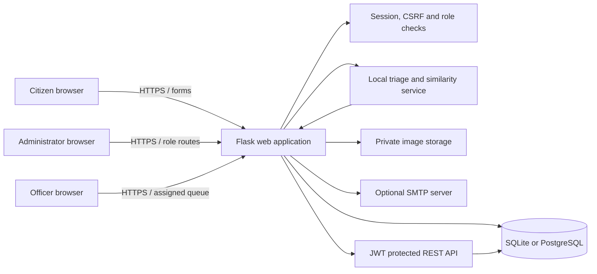
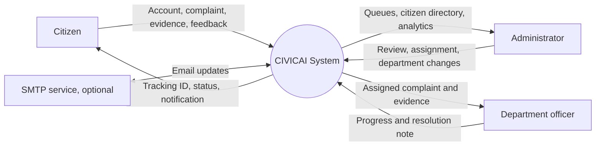
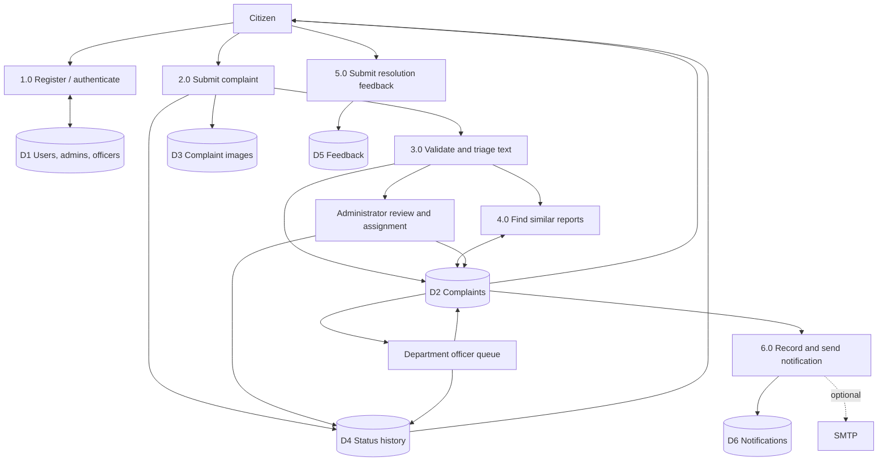
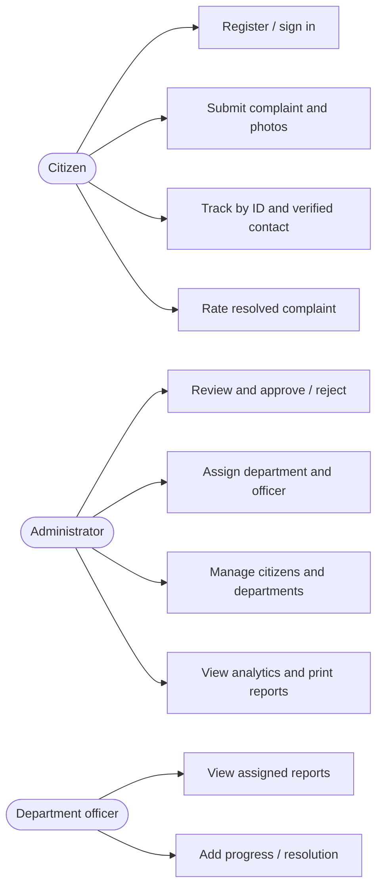
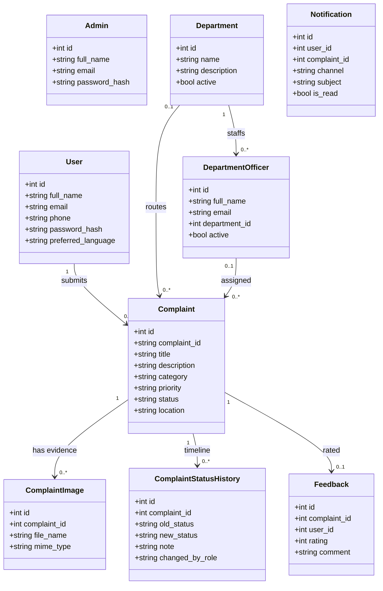
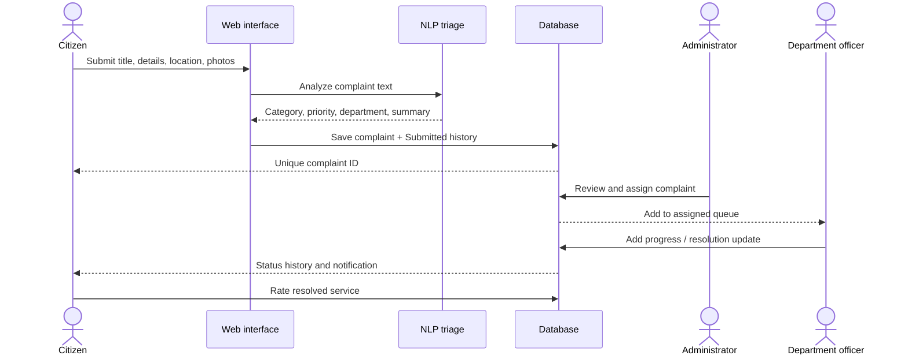
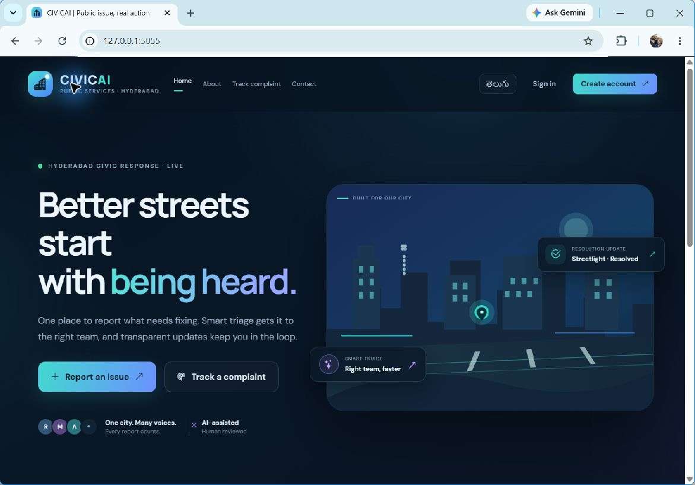

# CIVICAI — AI-Powered Public Complaint Management System

## Community Service Project Report

**Project type:** B.Tech Community Service Project (CSP) demonstration  
**Application:** Flask web application with PostgreSQL-compatible schema  
**Interface:** Responsive dark smart-city design with English and Telugu controls  
**Demonstration locality:** Hyderabad, Telangana  
**Prepared:** 10 November 2026

---

## 1. Project Title

**CIVICAI — AI-Powered Public Complaint Management System**

## 2. Abstract

Residents often report potholes, water interruptions, drainage blockages, uncollected waste, damaged streetlights and other public-service issues through disconnected channels. Reports may be difficult to route, hard to track and invisible to the people who raised them. CIVICAI demonstrates a shared digital workflow for citizens, administrators and department officers.

A citizen can register, submit a written report with a location and optional photographs, receive a unique tracking ID, and follow timestamped status changes. An offline, explainable language-analysis module suggests a civic category, urgency, responsible department and short summary. The administrator reviews suggestions and assigns a response team. Department officers add progress notes and close work. Citizens can leave a rating after resolution. Administrative dashboards summarize report volume, department demand, priority and completion.

The project is implemented with Python Flask, SQLAlchemy, SQLite for a quick local demonstration, and a PostgreSQL-compatible schema for deployment. Passwords are hashed, browser forms use CSRF tokens, staff routes are role-restricted, JWTs protect the REST API, and image uploads are validated and stored outside the public static directory. English and Telugu interface text is supported. The system is an educational prototype; AI triage is an aid for staff review and does not make official dispatch decisions.

## 3. Introduction

Local infrastructure problems have a direct effect on mobility, public health and safety. A reliable complaint process needs more than a form: residents need acknowledgement, the city needs routing and assignment, officers need a practical work queue, and all participants need a record of what happened.

CIVICAI uses a single complaint record as the hand-off point between these roles. It records the issue, category, urgency, location, department, responsible officer, images, current status and a chronological history. It also provides a citizen-facing tracking page and operational summaries for administrators.

## 4. Problem Statement

Public complaints can be lost or delayed when they arrive through separate channels, lack clear location details, are manually classified, or provide no tracking reference. Duplicate reports can create additional administrative work, while residents may not know whether a complaint was received, assigned or resolved. The project addresses these service gaps with a structured, transparent and role-based digital workflow.

## 5. Objectives

1. Provide a simple registration and complaint submission experience for citizens.
2. Generate a unique complaint reference and record a complete status history.
3. Suggest categories, urgency and responsible departments using explainable text analysis.
4. Give administrators tools to review, route, assign and report on complaints.
5. Give department officers a scoped queue for progress updates and resolution notes.
6. Protect user accounts, complaint details and uploaded evidence with server-side controls.
7. Support English and Telugu for core navigation and important interface text.
8. Demonstrate civic-service performance with status counts, monthly trends and department analytics.

## 6. Existing System

In a typical fragmented process, a resident may need to find a phone number, visit an office, use a separate portal, or post on social media. A report may not receive an easily reusable ID. Manual triage and routing can depend on the quality of the initial description. A citizen may have to call again to ask for progress. These observations describe the problem context for this demonstration; they are not a measured audit of any specific municipal authority.

## 7. Proposed System

CIVICAI provides a responsive web application with three account roles:

- **Citizen:** create an account, submit a report and evidence, track status, edit a profile and rate a resolved issue.
- **Administrator:** review all reports, change workflow status, select a department and officer, manage service teams and view analytics.
- **Department officer:** see only assigned reports, add resident-facing progress notes and mark field work resolved.

AI-derived values are visible as suggestions. A human administrator retains the review and assignment step. Public tracking asks for both the unique complaint ID and the registered email address or phone number.

## 8. System Requirements

### 8.1 Functional requirements

- Registration, login, logout, profile editing and role checks.
- Complaint creation with title, description, location, optional coordinates and image evidence.
- AI category, department, priority, summary and confidence suggestions.
- Duplicate similarity flag for staff review.
- Workflow states: Submitted → Under Review → Approved → Assigned → In Progress → Resolved; Rejected is available as a terminal outcome.
- Timestamped status history with actor role and comments.
- Citizen tracking, previous reports and resolution feedback.
- Admin views for citizens, complaints, departments, officers and reports.
- Officer queue restricted to assigned complaints.
- Aggregate dashboard charts and a print-friendly analytics report.
- JSON endpoints for token issue, triage, complaint list/create and public counters.
- Optional SMTP email and always-on in-app notification records.

### 8.2 Non-functional requirements

- Responsive layout for desktop, tablet and phone screens.
- Server-side validation and database-backed relationships.
- Hashed passwords, CSRF checks, role-based routes and signed JWTs.
- Upload size limits, image format validation and non-public file storage.
- Explainable baseline classification that works without a hosted AI service.
- Local SQLite startup with a PostgreSQL-ready deployment path.

## 9. Hardware Requirements

### Development / demonstration

- 64-bit PC or laptop with a modern browser.
- 2 CPU cores recommended; 4 GB RAM minimum for a basic local demo.
- Approximately 300 MB free disk for Python packages and project files, plus room for database and uploaded images.
- Internet connection for the CDN-hosted Bootstrap, Chart.js, Bootstrap Icons and Google Fonts assets. The Flask backend and triage module run locally.

### Server deployment

A small application server with 2 vCPU and 4 GB RAM is suitable for a classroom demonstration. Production sizing depends on complaint volume, image retention, database size and email traffic.

## 10. Software Requirements

| Layer | Technology |
|---|---|
| Operating system | Windows 10/11, Linux or macOS |
| Backend | Python 3.10+, Flask 3, Flask-SQLAlchemy |
| Data store | SQLite demo default; PostgreSQL DDL and Psycopg deployment option |
| Frontend | HTML5, CSS3, JavaScript, Bootstrap 5.3.8 |
| Charts and icons | Chart.js 4, Bootstrap Icons |
| Authentication | Werkzeug password hashing, signed HTTP-only Flask session, HMAC-SHA256 JWT |
| File handling | Pillow image verification; format-signature fallback |
| Email | Optional SMTP configuration |
| Deployment | Python development server for local demo; Docker Compose example |

## 11. System Architecture



The browser sends HTML form submissions or JSON API requests to Flask. Flask validates data, verifies session role or JWT claims, calls triage helpers, and persists records using SQLAlchemy. Uploaded files are stored in `instance/uploads` and returned only through a complaint-authorized endpoint. Aggregate dashboards query the same database. SMTP is optional; notification rows remain available when email is not configured.

## 12. Data Flow Diagram (DFD)

### 12.1 Level 0 — Context diagram



### 12.2 Level 1 — Complaint processing



## 13. Entity Relationship Diagram

```mermaid
erDiagram
  USERS ||--o{ COMPLAINTS : submits
  DEPARTMENTS ||--o{ DEPARTMENT_OFFICERS : contains
  DEPARTMENTS ||--o{ COMPLAINTS : receives
  DEPARTMENT_OFFICERS ||--o{ COMPLAINTS : handles
  COMPLAINTS ||--o{ COMPLAINT_IMAGES : includes
  COMPLAINTS ||--o{ COMPLAINT_STATUS_HISTORY : records
  USERS ||--o{ NOTIFICATIONS : receives
  COMPLAINTS ||--o{ NOTIFICATIONS : triggers
  USERS ||--o{ FEEDBACK : provides
  COMPLAINTS ||--o| FEEDBACK : receives
  COMPLAINTS }o--o| COMPLAINTS : similar_to
  USERS {
    int id PK
    string email UK
    string full_name
    string phone
    string password_hash
  }
  ADMINS {
    int id PK
    string email UK
    string full_name
    string password_hash
  }
  DEPARTMENTS {
    int id PK
    string name UK
    bool active
  }
  DEPARTMENT_OFFICERS {
    int id PK
    int department_id FK
    string email UK
    string password_hash
  }
  COMPLAINTS {
    int id PK
    string complaint_id UK
    int citizen_id FK
    int department_id FK
    int officer_id FK
    int duplicate_of_id FK
    string status
    string priority
  }
  COMPLAINT_IMAGES {
    int id PK
    int complaint_id FK
    string file_name
  }
  COMPLAINT_STATUS_HISTORY {
    int id PK
    int complaint_id FK
    string old_status
    string new_status
    string changed_by_role
  }
  NOTIFICATIONS {
    int id PK
    int user_id FK
    int complaint_id FK
    string channel
    bool is_read
  }
  FEEDBACK {
    int id PK
    int complaint_id FK_UK
    int user_id FK
    int rating
  }
```

The relational DDL and indexes are in [`schema.sql`](../schema.sql). SQLAlchemy creates the same tables for the running application. The model names are `users`, `admins`, `departments`, `department_officers`, `complaints`, `complaint_images`, `complaint_status_history`, `notifications` and `feedback`.

## 14. UML Diagrams

### 14.1 Use case view



### 14.2 Class / model view



### 14.3 Complaint status sequence



## 15. Database Design

| Table | Main purpose | Key relationships / constraints |
|---|---|---|
| `users` | Citizen identity and profile | Unique email; one citizen to many complaints and notifications |
| `admins` | Administrator sign-in | Unique email; hashed password |
| `departments` | Civic response teams | Unique department name; active/paused flag |
| `department_officers` | Staff accounts | Unique email; optional department foreign key |
| `complaints` | Core issue, AI output, routing and current status | Unique public ID; citizen FK; optional department/officer and duplicate self-FK; indexed status and date |
| `complaint_images` | Evidence file metadata | Complaint FK; stored file name, original safe name and MIME metadata |
| `complaint_status_history` | Immutable sequence of status updates | Complaint FK; timestamp, old/new values, actor role and note |
| `notifications` | In-app, email and contact-intake records | Optional citizen/complaint FKs; channel, read flag and timestamp |
| `feedback` | Resolution rating and comment | One feedback row per complaint; rating constrained to 1–5 |

IDs use integer primary keys. Timestamps use UTC at the application layer. Relationships use foreign keys and delete behavior appropriate to the demonstration. Complaint status and priority are validated in the application and constrained in the PostgreSQL reference schema. Email and complaint IDs are indexed or unique to make common lookups efficient.

## 16. Module Description

### Citizen module

Citizen registration validates required fields and hashes passwords. The profile page edits name, phone, address and language. Complaint submission checks title, description and location length; it handles up to three image files under a 5 MB total request limit. A unique `CVC-YYMMDD-XXXXXX` ID is returned. The citizen can view a personal list, open a detailed timeline, track with a verified contact value and leave one rating after resolution.

### Administrator module

The dashboard includes aggregate counters, department chart and latest complaint table. The queue supports search and status filtering. A complaint can be moved through review states, assigned to an active department and assigned to an officer in that department. Admins can inspect the citizen directory, create/activate/pause departments, provision officer logins and print analytics.

### Department officer module

Officer authentication verifies an active account. The officer dashboard and queue scope records to the officer ID. An authorized officer can add a note, move a complaint through workflow states, and record resolution. Other officers cannot open a complaint that is not assigned to them.

### AI triage module

`civicai/triage.py` uses weighted civic vocabulary in English and common Telugu civic terms. It ranks a finite set of service areas, applies transparent urgency phrase rules, returns a short extractive summary and a heuristic confidence value. A Jaccard token-overlap score flags potentially similar open reports. The triage preview is informational; administrator review remains mandatory. This is a baseline classifier, not an evaluated or trained production model.

### Notifications and email

Status changes create an in-app notification record. SMTP sends email only when configured and reachable. Contact form messages are stored in notification records with the `contact` channel. This classroom build does not include a dedicated contact-inbox screen or notification preference center.

## 17. Implementation

### Frontend

Jinja pages are composed through a shared base template and shared visual design system. Bootstrap 5.3.8 is loaded with version-specific Subresource Integrity values, while a custom CSS layer defines the dark navy, cyan, blue and purple smart-city interface. The home-page city scene is an inline vector illustration. Chart.js builds the admin monthly trend and department donut. JavaScript provides responsive navigation, password visibility, chart rendering, upload previews, geolocation assistance, character counting and asynchronous AI preview.

### Backend

Flask owns page routes, validation, sessions, access controls, notifications, JSON endpoints and CLI commands. SQLAlchemy maps the nine relational tables. Demo seeding is enabled by default for first-run demonstration and can be disabled with `CIVICAI_SEED_DEMO=0`. The local default is SQLite; PostgreSQL is enabled with `DATABASE_URL` and the optional `requirements-postgres.txt` dependency set.

### Security controls

- Passwords use Werkzeug's salted password hash helpers.
- Session cookies are HTTP-only, SameSite=Lax, and use the distinct `civicai_session` name.
- Every browser POST includes a session CSRF token checked with constant-time comparison.
- Role decorators restrict dashboards and records; citizens and officers are scoped by their IDs.
- The JSON API signs and verifies HS256 JWTs and applies an eight-hour expiry.
- SQL is expressed through SQLAlchemy parameterized queries.
- Uploads are limited to image extensions and MIME types, verified with Pillow when present, assigned random server names, size-limited, and stored outside the public static folder. Access to an uploaded image is checked against complaint ownership/assignment.
- Jinja auto-escaping is retained for user-provided content.

For a real public deployment, use HTTPS, random secrets, database migrations, rate limiting, automated backups, monitoring, account recovery controls, malware scanning, a defined retention schedule and a security review.

## 18. Testing

### Verification performed for this deliverable

- Python compilation completed successfully for `app.py` and `civicai/`.
- Flask application import succeeded and registered 34 routes.
- An in-memory SQLite smoke run rendered the public, citizen, administrator, officer and analytics pages.
- An end-to-end test-client workflow passed: citizen submission, verified and rejected-contact tracking, admin department/officer assignment, officer progress update and resolution, citizen feedback, and contact message persistence.
- The REST smoke run obtained a JWT and exercised complaint list and creation endpoints.
- A local browser rendered the home page at desktop width; a screenshot is included below.

### Acceptance checklist for a classroom presentation

| Test | Expected result |
|---|---|
| Citizen registration with valid fields | Account is created; password is hashed; citizen dashboard opens |
| Invalid password / short password | No session is created; validation message appears |
| Submit incomplete complaint | Inline browser checks and server validation prevent saving |
| Submit valid complaint | Unique ID, AI suggestion, initial history row and notification are created |
| Attach invalid image type | File is not saved as evidence |
| Public tracking with wrong contact | Complaint details remain hidden |
| Admin opens citizen-only route | Access is refused or redirected to the correct portal |
| Admin assigns officer to wrong department | Incompatible assignment is ignored |
| Officer opens an unassigned complaint | Access is refused |
| Officer resolves report | Citizen sees timestamped resolution note and feedback action |
| Feedback rating outside 1–5 | Server validation prevents saving |
| API call without / with invalid JWT | JSON 401 response |
| API complaint creation with citizen JWT | Complaint is created in the caller's account scope |
| Mobile viewport | Navigation collapses; forms, tables and dashboard panels adapt |

These checks demonstrate the main flows, but they are not a formal penetration test or a performance benchmark.

## 19. Results and Screenshots

The demonstration application renders the public homepage, citizen registration/login, issue reporting and tracking screens, role dashboards, administration tools, officer workspace, analytics, profile and feedback pages. Complaint records persist to SQLite by default; the same model is suitable for PostgreSQL through the provided connection setting. The test-client workflow successfully exercised a complete report-to-feedback journey.

### Screenshot 1 — CIVICAI public home page



### Demonstration result

1. Citizen submits a road issue and receives a unique tracking ID.
2. The administrator reviews the AI suggestion and assigns the roads team and an officer.
3. The officer records progress and marks the issue resolved.
4. The citizen verifies the report, sees the timestamped history and submits a rating.

The remaining screens are accessible from their corresponding role routes during the local demonstration. See the README's test checklist and sample account table for presentation steps.

## 20. Advantages

- Gives citizens a reusable tracking ID and visible complaint history.
- Organizes the hand-off between residents, administrators and field officers.
- Keeps routing suggestions explainable and reviewable.
- Flags possible duplicates for coordination without silently merging reports.
- Supports optional photo evidence and precise location coordinates.
- Uses one shared database model for dashboards, queues and API access.
- Starts locally with SQLite and supports a PostgreSQL deployment path.
- Uses responsive layouts and English/Telugu UI support.

## 21. Limitations

- Keyword-based triage is a small baseline and may miss context, spelling variants or uncommon Telugu phrasing.
- Confidence values are heuristics, not calibrated statistical probabilities.
- Similarity uses token overlap and does not prove that two reports describe the same incident.
- Email delivery is optional and requires a configured SMTP service.
- No map/geocoding provider is connected; coordinates are captured only when browser location is available and the citizen permits it.
- The demonstration does not include password reset, account verification, a contact inbox screen, bulk exports, service-level alerting or formal accessibility certification.
- The sample dataset and logins are demonstration-only and must not be used as production credentials.
- Bootstrap, icons, fonts and Chart.js are loaded from CDNs, so an internet connection is required for those assets.

## 22. Future Enhancements

1. Train and evaluate a multilingual English/Telugu classifier using reviewed, consented and representative complaint data.
2. Add admin-configurable service-level targets and alert rules for overdue high-priority work.
3. Integrate a map/geocoder and ward boundary lookup with explicit location consent.
4. Add account verification, password reset, MFA for staff and throttling against brute-force login.
5. Provide a dedicated contact inbox and notification preference controls.
6. Add database migrations, role/department audit logs, backups and retention tooling.
7. Add document exports, CSV downloads and scheduled report generation.
8. Conduct accessibility, localization, security and load testing with real users and stakeholders.
9. Support more languages and a low-bandwidth progressive web application mode.

## 23. Conclusion

CIVICAI demonstrates how a digital complaint workflow can connect a citizen report to human review, a department assignment, officer progress and resident feedback. It provides the core pages, database tables, access controls, image handling, API, analytics and an explainable bilingual triage baseline needed for a Community Service Project demonstration. The build makes complaint progress visible while preserving human responsibility for priority and routing decisions. Evaluation with real municipal stakeholders and representative data would be the next step before considering any public-service use.

---

## Appendix A — Local installation and demo credentials

See [`README.md`](../README.md) for Windows setup, PostgreSQL / Docker options, API examples and the following sample accounts:

- Citizen: `citizen@civicai.demo` / `CivicAI@2026`
- Administrator: `admin@civicai.demo` / `CivicAI@2026`
- Department officer: `officer@civicai.demo` / `CivicAI@2026`

Use these credentials only in a local demo. Replace secrets and credentials before a shared deployment.

## Appendix B — API example

```http
POST /api/triage
Content-Type: application/json

{
  "title": "Water leak near the clinic",
  "description": "A pipe is leaking across the footpath next to the clinic entrance."
}
```

```json
{
  "category": "Water Supply",
  "department": "Water Supply",
  "priority": "Medium",
  "confidence": 0.96,
  "summary": "A pipe is leaking across the footpath next to the clinic entrance.",
  "method": "Explainable keyword-weighted NLP demo"
}
```
